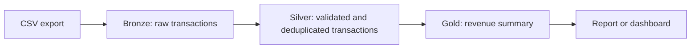

# Data Engineering Exercise: Clean Customer Transactions

## Goal

The retail operations team has exported one month of customer transactions. They suspect that some records were written more than once and need a reliable revenue total before comparing it with the payment system.

Analyze the file, clean the data, and explain your decisions. You do not need to deploy anything to the cloud.

## Input file

`dedup/amazon_customer_transactions.csv`

The file should contain one transaction record per row:

| Column            | Meaning                                   |
| ----------------- | ----------------------------------------- |
| `transaction_id`  | Unique ID expected for a transaction      |
| `customer_id`     | Customer ID                               |
| `product`         | Product name                              |
| `amount`          | Transaction revenue                       |
| `order_timestamp` | When the order was placed                 |
| `recorded_at`     | When the record was written by the system |

## Part 1: Find and clean duplicates

1. Load the data and check its row count, columns, data types, missing values, and unusual values.
2. Find every `transaction_id` that appears more than once.
3. Separate exact duplicate rows from duplicate IDs with conflicting values, such as different amounts.
4. Define which row to keep and which rows to remove or quarantine. Explain why.
5. Calculate the total revenue after cleaning. Include the row count and, if useful, the revenue before cleaning for comparison.

### Suggested default rule

Use this rule unless you can justify a better one:

- For exact duplicate rows, keep one copy.
- For the same `transaction_id` with different values, keep the row with the latest `recorded_at`, because it is the most recent system record.
- Flag any unresolved or suspicious conflict for the operations team instead of silently hiding it.

## Part 2: Show a simple medallion architecture

Place your solution in this flow:

Briefly describe what belongs in each layer:

- **Bronze:** Keep the source rows as received. Add simple metadata such as `source_file`, `batch_id`, and `ingested_at` so the load can be audited or replayed.
- **Silver:** Parse the types, apply data-quality checks, and make the duplicate decision. The target grain should be one row per `transaction_id`.
- **Gold:** Create a small reporting table or view, such as daily revenue by product. Include useful fields such as `order_date`, `product`, `transaction_count`, and `revenue`.

Show where deduplication happens and explain how a rerun avoids counting the same transaction twice. Folders, database schemas, or Fabric lakehouse schemas are all acceptable implementations.

## Part 3: Create one visualization

Create at least one clear chart from the cleaned Gold data. Choose one:

- daily revenue, or
- revenue by product.

The chart must have a title, labeled axes, and readable units. Add one or two sentences explaining the main pattern or anything that deserves investigation. A useful optional comparison is daily revenue before versus after deduplication.

## Deliverables

Submit a notebook, SQL script, or short analysis containing:

1. The duplicate transaction IDs and the records involved.
2. The keep/remove/quarantine rule and its reasoning.
3. The cleaned row count and total revenue.
4. A short Bronze -> Silver -> Gold design.
5. At least one visualization based on the cleaned data.
6. A short closing report for retail operations, including anything they should double-check before relying on the number.

## Practicalities

Use Python, SQL, or a mix of both. Keep the solution small and easy to follow; a production deployment is not required.

Assume the export comes directly from the order system and has not been cleaned. If a definition or final decision is ambiguous, choose a reasonable option and explain it. Your results and your reasoning are both assessed.

## Suggested closing report

Include these points in a few paragraphs or bullets:

- how many raw rows were reviewed;
- how many duplicate IDs and duplicate rows were found;
- how many rows were removed or quarantined;
- revenue before and after cleaning;
- any conflicting records, missing values, invalid amounts, or timestamp issues that should be checked against the payment system.